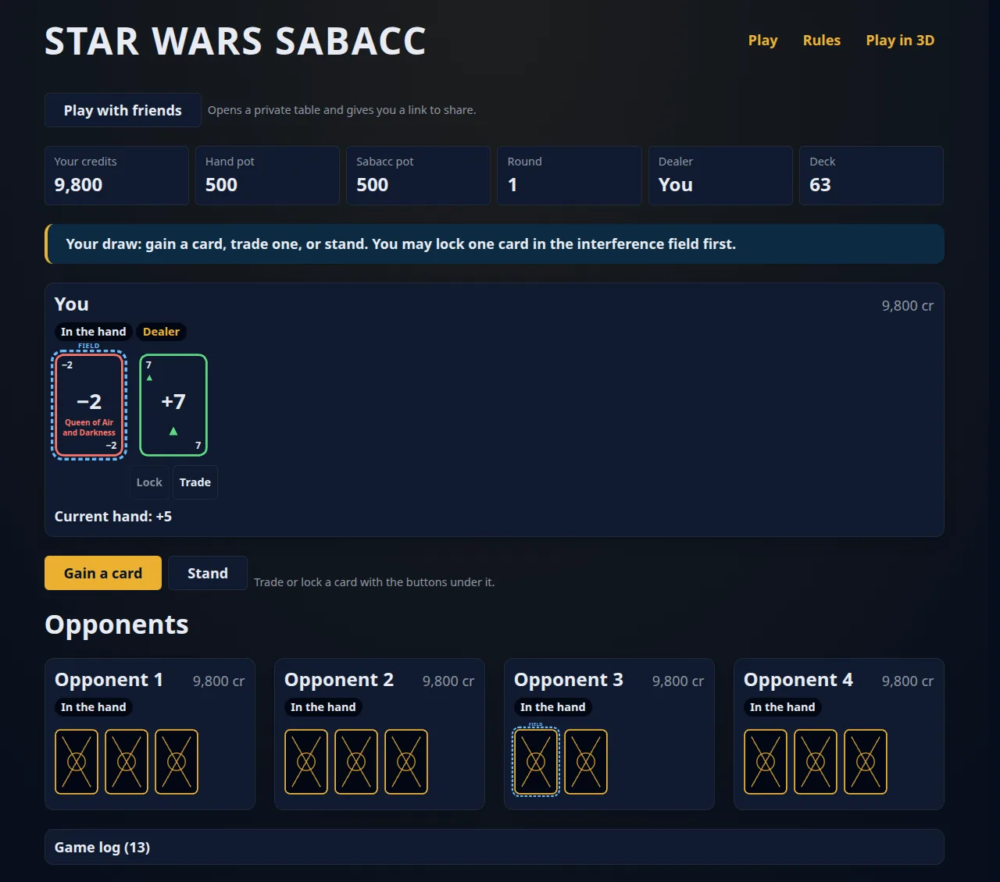
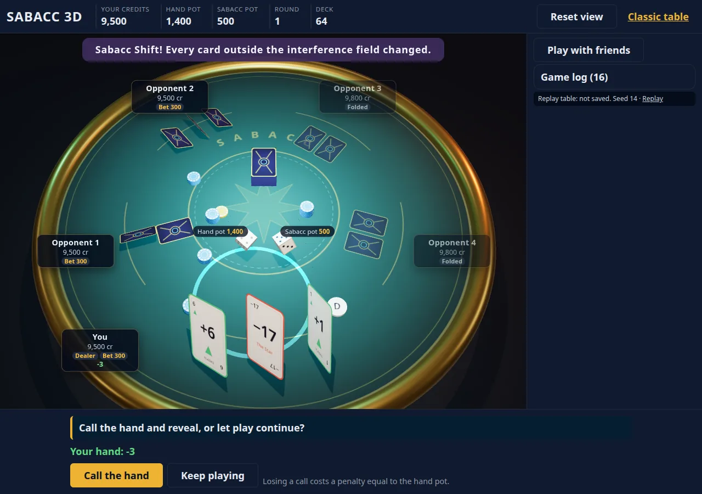

# Star Wars Sabacc

[](https://github.com/mikezupper/sabacc/actions/workflows/ci.yml)
[](https://sabacc.starwars.run/)
[](LICENSE)
[](https://nodejs.org/)
[](tsconfig.json)
[](https://effect.website)
[](https://github.com/gyraljs/gyral)
[](https://threejs.org/)
[](CONTRIBUTING.md)

Classic (Legends) Sabacc, the card game Lando lost the *Falcon* in, in your browser. Get
your hand as close to **+23 or −23** as you can, lock the cards you trust in the
interference field, and survive the **Sabacc Shift** that can change every other card at
any moment. Play four droids solo, or open a table and send friends the link.

**[Play it at sabacc.starwars.run](https://sabacc.starwars.run/)** · [3D table](https://sabacc.starwars.run/3d.html) · [The rules](docs/product-specs/sabacc-rules.md)

| Classic table | 3D table |
|---|---|
| [](https://sabacc.starwars.run/) | [](https://sabacc.starwars.run/3d.html) |

## Contents

- [Features](#features)
- [Why this exists](#why-this-exists)
- [Quick start](#quick-start)
- [Architecture](#architecture)
- [Conventions](#conventions)
- [Testing and validation](#testing-and-validation)
- [Build, deploy and configure](#build-deploy-and-configure)
- [Contributing](#contributing)
- [Documentation map](#documentation-map)
- [License and credits](#license-and-credits)

## Features

- **Legends-accurate rules.** A 76-card deck with sixteen face cards, two pots, no-limit
  betting with side pots, the Idiot's Array, Pure Sabacc, bomb-out penalties, sudden
  demise and the interference field. Every rule in the
  [spec](docs/product-specs/sabacc-rules.md) is tagged with its source: Legends lore, the
  West End Games fan reconstruction, canon, or a recorded house choice.
- **Two views of one engine.** A static, semantic, crawlable classic page and a
  Three.js table where cards fly, dice tumble and shifted cards spin over. Both share the
  store, the wording, the controls and the saved game.
- **Solo or multiplayer.** Solo, the engine runs in your browser and the table is saved
  in `localStorage`. With friends, a small Node server runs the same engine per table
  over WebSockets: up to five players, droids fill empty seats, a turn clock, 30 s to
  reconnect before a droid takes over, and spectators.
- **No cheating by design.** Each browser receives only its own seat's view; other
  hands and the deck never leave the server.
- **Reproducible.** All randomness goes through Effect's `Random` service. `?seed=42`
  replays a table exactly, and the seed is shown under the table for bug reports.
- **Accessible.** Landmarks, a skip link, named cards, live status messages, 44 px hit
  targets, keyboard play in both views, light and dark themes, and instant playback
  under `prefers-reduced-motion`.
- **No image assets.** Cards, table and chips are drawn in SVG or on canvases.

## Why this exists

Sabacc is the best-known card game in Star Wars and one of the least playable: the films
show it but never explain it, and the rules that exist are scattered across Legends
novels, a 1990s West End Games supplement and fan reconstructions. This project collects
them into one sourced spec ([lore notes](docs/references/sabacc-lore.md)) and turns it into
a game you can actually play.

It's also a working testbed for three ideas:

1. **A pure, typed rules engine.** Every rule lives in `src/domain/`, written with
   [Effect](https://effect.website) as plain functions over immutable data. No DOM, no
   `throw`, no `Math.random`. The same engine runs in the browser for solo play and on
   the server for multiplayer, and is checked by unit and property tests and a headless
   simulator that plays thousands of hands.
2. **A real app on [Gyral](https://github.com/gyraljs/gyral).** The UI was built on Lit,
   then rewritten as Gyral Model-View-Intent web components to put the framework through
   a real project. What we learned goes back to the Gyral team
   ([feedback](docs/references/gyral-feedback.md)).
3. **A repo that agents can work in.** The docs are the system of record, the
   architecture is enforced by lints whose errors explain the fix, and `npm run drive`
   lets an agent (or you) see the real UI in screenshots. [AGENTS.md](AGENTS.md) is the
   map; much of the code was written by AI coding agents under that harness, with a
   human deciding the rules and reviewing the result.

## Quick start

Requires **Node 24** (what CI and the Docker image use; the server runs its TypeScript
directly with Node's type stripping and uses the built-in `node:sqlite`) and npm.

```bash
git clone https://github.com/mikezupper/sabacc.git
cd sabacc
npm install
npx playwright install chromium   # once: browser tests and npm run drive need it
npm run dev                       # http://localhost:5173 (3D at /3d.html, ?seed=42 replays a table)
```

For multiplayer during development, run the server alongside Vite (it proxies `/api`
and `/ws` to it):

```bash
npm run dev:server                # multiplayer server on :8787, saves to .data/
```

Reaching the dev server through a tunnel or another host name? List them in
`SABACC_DEV_HOSTS` (comma separated, e.g. `SABACC_DEV_HOSTS=.example.com npm run dev`).

Before you push anything, run the gate:

```bash
npm run check                     # typecheck, lints, unit + browser tests, production build
```

### Commands

| Command | Does |
|---|---|
| `npm run dev` | Vite dev server at <http://localhost:5173> |
| `npm run dev:server` | Multiplayer server on :8787 with `--watch` |
| `npm run build` | Production build to `dist/` |
| `npm start` | The built site and the multiplayer server on :8080 (what the image runs) |
| `npm run check` | `typecheck` → `lint:arch` → `lint:templates` → `test` → `build`; the merge gate |
| `npm run typecheck` | Generates Gyral element typings, then `tsc --noEmit` (strict) |
| `npm run lint:arch` | Layer edges, domain purity and doc links |
| `npm run lint:templates` | Gyral's template rules (ESLint) over `src/components` and `src/scene` |
| `npm test` | Vitest: `unit` (Node) and `browser` (Playwright Chromium) projects |
| `npm run sim` | Plays thousands of seeded hands headlessly and prints JSON stats |
| `npm run drive` | Boots the build and plays scripted paths in Chromium; screenshots in `.drive/` |

## Architecture

```text
 index.html ─ entry-client.ts          3d.html ─ entry-3d.ts
        │                                     │
        │                               src/scene/          Three.js table, <sabacc-3d> HUD
        ▼                                     │
 src/components/  ◄───────────────────────────┘             Gyral components, table driver
        │
 src/presentation/                                          wording, prompts, beat playback
 src/state/          local store (engine in the browser) or remote store (WebSocket)
        │
 src/protocol/       wire messages as Effect Schemas  ◄──── src/server/  (Node: rooms, timers,
        │                                                                 SQLite, HTTP + WS)
 src/domain/         pure rules: engine, AI, viewFor  ◄──────────┘
        │
     effect
```

Dependencies only point down, and `npm run lint:arch` fails the build if one doesn't.

- **One transition per command.** A move becomes a command; the store runs
  `applyCommand(game, command)` from `src/domain/engine.ts` once, synchronously, with a
  seeded `Random`. Your move, every droid's turn, shift rolls and step changes up to your
  next decision resolve in that one call and come back as a list of *beats* (an event plus
  the game right after it). No timer, component or 3D object holds game state.
- **Playback is presentation.** Each view plays the beats back one at a time (opponents
  acting, a shift) with `@gyral/time` timers, while the store's game is already final.
  Skipping or reduced motion never leaves the table wrong.
- **Multiplayer reuses everything.** The server holds one `Room` per table, runs the same
  `applyCommand` under a lock, saves to SQLite and sends each connection
  `transitionFor(t, seat)`: hidden hands and deck removed, seats rotated so every player
  sits in seat 0. The browser's remote store exposes the same cells as the local one, so
  the views can't tell which they're talking to.
- **Untrusted input is decoded.** Wire messages and saved games go through Effect
  Schemas that also check invariants (credits add up, card ids are unique).

[ARCHITECTURE.md](ARCHITECTURE.md) has the full layer table, the data flow step by step,
the 3D view, persistence and a "where things live" index.

### Stack

| Part | Uses |
|---|---|
| Rules engine | [Effect](https://effect.website) 3 (`Random`, `Schema`, tagged errors), TypeScript strict |
| UI | [Gyral](https://github.com/gyraljs/gyral) 0.3.7 web components, modern CSS (layers, `oklch`, container queries) |
| 3D | [Three.js](https://threejs.org/) with canvas-drawn textures, CSS2D name plates |
| Server | Node 24, `@effect/platform-node` HTTP and WebSockets, `node:sqlite` |
| Build and tests | Vite 8, Vitest 4 with Playwright Chromium, ESLint (Gyral template rules) |
| Work tracking | [beads](https://github.com/gastownhall/beads) (`bd`) |

## Conventions

The ones that are enforced (break them and `npm run check` fails):

1. **`src/domain/` is pure.** It imports only `effect`: no `throw`, `try`, `async`,
   `Math.random`, `Date.now`, DOM, `any`, non-null `!`, or classes other than
   `Data.TaggedError`/`Data.Class`, and no file over 300 lines.
2. **Game state changes only through `applyCommand`**, run by the store (solo) or the
   server's `Room` (multiplayer).
3. **Rules change spec first:** edit
   [sabacc-rules.md](docs/product-specs/sabacc-rules.md), then `src/domain/`, then the
   rules copy in `index.html`. `test/unit/rules-copy.test.ts` catches drift.
4. **`three` is imported only under `src/scene/`**, so the classic page never ships it;
   `@gyral/*` only in `src/components/` and `src/scene/`.
5. **A browser receives only its own seat's view.** Never another hand or the deck.
6. **Browser tests run in real Chromium.** No jsdom.
7. **Every fixed bug gets a regression test** that fails on the old behaviour.

And the house style:

- Gyral components follow Model-View-Intent: `intent` parses events into tagged
  messages, `update` is a pure reducer, `view` names intents and never holds closures.
  Element names use the `sabacc-` prefix, one element per file.
- The platform first: `<details>`, `<output aria-live>`, `<data>`, native form controls;
  global CSS in cascade layers, colours in `oklch()`, both themes via `light-dark()`,
  component styles in shadow roots. No UI kits, no CSS-in-JS.
- TypeScript: two-space indent, no semicolons, double quotes, `.ts` extensions in
  imports. Match the surrounding code.
- Commits: a short imperative summary ("Fix responsive 3D layouts"), a body that says why.

Details: [docs/FRONTEND.md](docs/FRONTEND.md) (Gyral, HTML, CSS, SEO) and
[docs/design-docs/core-beliefs.md](docs/design-docs/core-beliefs.md) (the principles and
what enforces each).

## Testing and validation

- **Unit and property tests** (`test/unit/`, Node): the engine, scoring, side pots,
  persistence, the protocol, the server over real WebSockets, the 3D layout math, and
  DOM-free Gyral model tests.
- **Browser tests** (`test/browser/`, Playwright Chromium via Vitest): both tables,
  component lifecycles, real WebGL in the 3D view.
- **Simulation:** `npm run sim` plays thousands of seeded hands and reports win types,
  rounds, shifts and bomb-out rates. It's how the spec's numbers were checked.
- **Drive:** `npm run build && npm run drive` plays scripted paths (classic, 3D, shifts,
  layout, a two-browser multiplayer hand) in both themes at desktop and phone sizes,
  saves screenshots to `.drive/` and fails on any console error. Narrow it with
  `-- --seed 7 --path fold`.

CI runs `npm run check` on every push to `main`, on a self-hosted runner.

## Build, deploy and configure

One Docker image serves everything on port 8080: both pages, the multiplayer API
(`/api/rooms`), the WebSocket (`/ws`) and a health check (`/healthz`). Tables are saved in
SQLite on the `/data` volume.

```bash
./scripts/docker-build.sh                                 # sabacc:<git sha> and sabacc:latest (linux/amd64)
docker run --rm -p 8080:8080 -v sabacc-data:/data sabacc  # http://localhost:8080

npm run build && npm start                                # the same thing without Docker
```

For production, [`compose.yml`](compose.yml) runs the image behind
[Traefik](https://traefik.io/) with TLS. Nothing about a particular registry or host is
committed: copy [`.env.example`](.env.example) to `.env` and set your image, tag, host
name and Traefik names there. [docs/DEPLOY.md](docs/DEPLOY.md) covers pushing to a
registry, updates and rollbacks, logs, and nightly SQLite backups.

### Settings

The server reads these from the environment:

| Variable | Default | Meaning |
|---|---|---|
| `PORT` | `8080` | Listening port |
| `DATA_DIR` | `.data` (`/data` in the image) | SQLite database and backups |
| `STATIC_DIR` | `dist` (`/app/dist` in the image) | The built site it serves |
| `TURN_SECONDS` | `45` | Turn clock; on timeout: check if possible, else fold, stand or pass |
| `GRACE_SECONDS` | `30` | How long a dropped player's seat waits before a droid plays it |
| `AUTO_DEAL_SECONDS` | `20` | Pause between hands |
| `HEARTBEAT_SECONDS` | `25` | Keep-alive on idle connections |
| `IDLE_CLOSE_SECONDS` | `1800` | An empty room leaves memory (it stays saved) |
| `DELETE_AFTER_SECONDS` | `86400` | A room untouched this long is deleted |
| `ROOMS_PER_IP_PER_HOUR` | `20` | New tables per address per hour (kept in memory, never stored) |

`compose.yml` adds `SABACC_IMAGE`, `SABACC_TAG`, `SABACC_HOST` and the Traefik names;
see [DEPLOY.md](docs/DEPLOY.md#settings).

## Contributing

Contributions are welcome: bug reports with a seed, rules corrections with a source, UI
and accessibility fixes, tests. Read [CONTRIBUTING.md](CONTRIBUTING.md) first; it covers
setup, the workflow, what a good pull request includes and how CI works for forks. Please
follow the [Code of Conduct](CODE_OF_CONDUCT.md), and report security issues privately
as described in [SECURITY.md](SECURITY.md).

Using an AI coding agent? Point it at [AGENTS.md](AGENTS.md): it's written for that.

## Documentation map

| You want… | Read |
|---|---|
| The rules (source of truth) | [docs/product-specs/sabacc-rules.md](docs/product-specs/sabacc-rules.md) |
| How the rules compare with Star Wars lore | [docs/references/sabacc-lore.md](docs/references/sabacc-lore.md) |
| Layers, data flow, where things live | [ARCHITECTURE.md](ARCHITECTURE.md) |
| Why things are the way they are | [docs/design-docs/core-beliefs.md](docs/design-docs/core-beliefs.md) |
| Gyral, HTML, CSS and SEO conventions | [docs/FRONTEND.md](docs/FRONTEND.md) |
| Deploying, settings, backups | [docs/DEPLOY.md](docs/DEPLOY.md) |
| How good each area is, and known debt | [docs/QUALITY_SCORE.md](docs/QUALITY_SCORE.md), [tech-debt-tracker.md](docs/exec-plans/tech-debt-tracker.md) |
| Past plans and decisions | [docs/exec-plans/completed/](docs/exec-plans/completed/) |
| The map for agents (and humans) | [AGENTS.md](AGENTS.md) |

## License and credits

Code is [MIT](LICENSE) © Mike Zupper.

This is a non-commercial fan project. It is not affiliated with, sponsored or endorsed
by Lucasfilm Ltd. or The Walt Disney Company. Star Wars, Sabacc and related names are
trademarks of their respective owners and are used here only to describe the game. The
project contains no artwork, music or text from Star Wars productions.

Rules sources are cited in the [lore reference](docs/references/sabacc-lore.md),
including Wookieepedia and the fan reconstructions of the West End Games rules.
